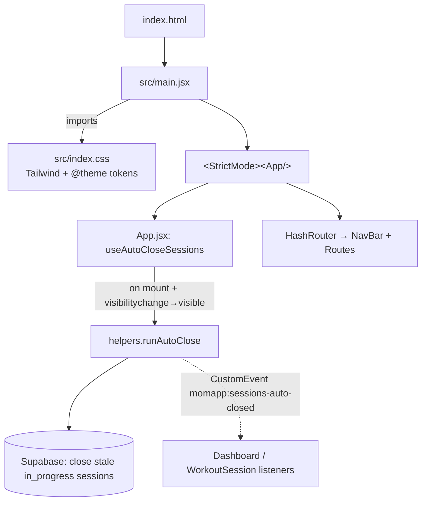
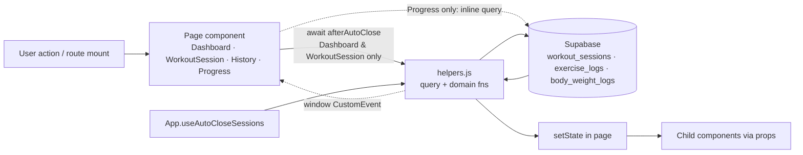

# momapp — Architecture Audit (pre-redesign)

> Read-only snapshot of how the app is built today, written before the UI rebuild.
> Audited at commit `b158c3b` ("Block 01: 4-day queue program, session lifecycle, …"), branch `main`, 2026-10-21.
> All paths are relative to the repo root (`momapp/`). Line counts come from `wc -l`.

**What the app is:** "Strength & Tone", a single-user workout tracker for Arlene. It uses React 19, Vite 8, Tailwind v4 and Supabase, is deployed to GitHub Pages under `/momapp/`, and has **no auth**. The current program is Block 01: a 4-day queue (Upper A → Lower A → Upper B → Lower B), 24 sessions per block, and an auto-deload in week 6.

**Constraint the redesign must respect** (from `CLAUDE.md`): the Supabase data contract (what gets written to which column) is **frozen for Block 01**.

---

## 1. Folder structure

### 1.1 Annotated tree

```
momapp/                              git repo root (parent MomProgram/ is NOT in the repo)
├── CLAUDE.md                        Current, accurate architecture notes (more up to date than README)
├── README.md                        STALE: describes Phase 1 5-day program, PROGRAM_START_DATE, body diagram
├── index.html                       HTML shell: Google Fonts (Nunito + Inter), manifest, iOS standalone metas
├── package.json                     Deps + scripts (dev/build/lint/preview/deploy via gh-pages)
├── package-lock.json
├── vite.config.js                   react() + tailwindcss() plugins, base: '/momapp/'
├── .oxlintrc.json                   oxlint: react/rules-of-hooks (error), react/only-export-components (warn)
├── .gitignore                       node_modules, dist, *.local, editor files
├── public/
│   ├── manifest.json                PWA manifest (standalone, scope /momapp/, theme #e2685c, one SVG icon)
│   ├── favicon.svg                  DEFAULT Vite logo (purple bolt), also used as the manifest icon
│   └── icons.svg                    DEAD: Vite template social-icon sprite (bluesky etc.), referenced nowhere
├── supabase/
│   ├── schema.sql                   Reference schema, idempotent (tables, unique index, RLS, indexes)
│   └── block01-migration.sql        One-off, hand-run Block 01 data migration (already applied 2026-10-20)
├── docs/
│   └── architecture-audit.md        This file
└── src/
    ├── main.jsx                     createRoot + <StrictMode><App/>; imports index.css
    ├── App.jsx                      HashRouter, routes, NavBar, auto-close hook (81 lines)
    ├── index.css                    Tailwind import + @theme tokens + .card/.glass/.accent-gradient (60 lines)
    ├── lib/
    │   └── supabase.js              Supabase client: hardcoded URL + anon key, db.schema = 'momapp'
    ├── data/
    │   ├── program.js               Program content + block constants + option lists (479 lines)
    │   ├── helpers.js               God-module: ALL Supabase queries + ALL domain logic + formatters (938 lines)
    │   └── quotes.js                Daily quote list + deterministic getDailyQuote() (47 lines)
    ├── pages/                       One file per route
    │   ├── Dashboard.jsx            Home tab (140)
    │   ├── WorkoutSession.jsx       Live workout at /session/:dayId (597, the largest file)
    │   ├── History.jsx              History tab, incl. inline editing (354)
    │   └── Progress.jsx             Progress tab, incl. one inline Supabase query (74)
    ├── components/                  Flat folder, mixed generic and feature-specific
    │   ├── BodyWeightForm.jsx       (48)   BodyWeightPanel.jsx   (93)
    │   ├── EffortTap.jsx            (35)   ExerciseCard.jsx      (271)
    │   ├── ExerciseProgressPanel.jsx(185)  ExerciseSelect.jsx    (53)
    │   ├── InfoTooltip.jsx          (26)   LastSetDifficultyTap.jsx (24)
    │   ├── StatTile.jsx             (16)   TodayWorkoutCard.jsx  (115)
    │   ├── TrendLineChart.jsx       (42)   WeekStrip.jsx         (44)
    │   └── WeighInCard.jsx          (28)
    └── assets/
        ├── hero.png                 DEAD: referenced nowhere
        ├── react.svg                DEAD: Vite template leftover
        └── vite.svg                 DEAD: Vite template leftover
```

Outside the repo, `MomProgram/momapp_fresh.zip` (Jul 13) sits in the parent folder. It is not tracked.

### 1.2 Config that matters

| Concern | Where | Notes |
|---|---|---|
| Build | `vite.config.js` | `plugins: [react(), tailwindcss()]`, `base: '/momapp/'` (must match GH repo name) |
| Runtime deps | `package.json` | `react`/`react-dom` ^19.2, `react-router-dom` ^7.18 (HashRouter), `@supabase/supabase-js` ^2.110, `recharts` ^3.9 (charts), `lucide-react` ^1.23 (icons). `gh-pages` is listed under **dependencies** but is a dev tool. |
| Dev deps | `package.json` | `tailwindcss` + `@tailwindcss/vite` ^4.3, `oxlint`, `@vitejs/plugin-react`. `autoprefixer` + `postcss` are installed, but there is **no postcss config**, so they're unused (Tailwind v4 runs through its own Vite plugin). |
| Env vars | — | **None.** There is no `import.meta.env` usage and no `.env` file. The Supabase URL and anon key are hardcoded in `src/lib/supabase.js` (intentional per `CLAUDE.md`). |
| Deploy | `package.json` scripts | `predeploy: vite build` → `deploy: gh-pages -d dist` pushes `dist/` to the `gh-pages` branch (remote `origin` = `github.com/Jrodriguez102/momapp`). There is no CI. |
| PWA | `public/manifest.json`, `index.html` | Manifest + `apple-mobile-web-app-*` metas. There is **no service worker** (so no offline support), **no PNG / apple-touch-icon**, and the icon is the Vite default logo. |
| Lint | `.oxlintrc.json` | Two rules. `npm run lint` passes clean at this commit. |
| Tests | — | None configured. |

---

## 2. Entry points and routing

### 2.1 Boot sequence



- **There are no providers.** No context, no QueryClient, no theme provider, no auth provider. `App` renders `HashRouter`, then a wrapper `div` (`pb-24 md:pt-24` to clear the nav), then `NavBar` and `Routes`.
- **Module-level singletons in `helpers.js`:** `autoCloseInFlight` and `lastAutoCloseRun` dedupe auto-close runs. `afterAutoClose()` is the barrier pages await before counting sessions. Child effects run before App's effect, so `afterAutoClose()` kicks off the first run itself (`src/data/helpers.js:195`).

### 2.2 Routes

Router: **react-router-dom v7 `HashRouter`** (URLs look like `/momapp/#/history`), so GitHub Pages needs no 404 rewrite.

| Path | Element | File | In nav? |
|---|---|---|---|
| `/` | `Dashboard` | `src/pages/Dashboard.jsx` | Yes, "Home" (`LayoutDashboard` icon) |
| `/session/:dayId` | `WorkoutSessionRoute` → `<WorkoutSession key={dayId}/>` | `src/App.jsx:13`, `src/pages/WorkoutSession.jsx` | No |
| `/history` | `History` | `src/pages/History.jsx` | Yes, "History" |
| `/progress` | `Progress` | `src/pages/Progress.jsx` | Yes, "Progress" |
| anything else | **nothing renders** (no catch-all / 404 route) | — | — |

`dayId` values come from `PROGRAM_DAYS` ids: `day-1` … `day-4`. An unknown id renders "Day not found." (`WorkoutSession.jsx:205`).

### 2.3 Navigation mechanics

- `NavBar` (`App.jsx:24`) is a floating dark pill. It's fixed at the bottom on mobile and at the top-center from `md:` up. It uses `NavLink` with `isActive`: the active tab gets a white sub-pill, a coral icon and a text label, and **inactive tabs show only the icon**.
- Programmatic navigation uses `useNavigate()`:
  - `Dashboard` → `/session/${dayId}`, through `TodayWorkoutCard.onStart`.
  - `WorkoutSession` → `/` from "Back", "Back to Home" and the result screens, and → `/session/${otherSession.day_id}` from "Continue".
- **The nav bar stays visible during a live workout.** There's no full-screen session mode.
- **Keying on `dayId`** in `WorkoutSessionRoute` forces a remount, so the lazy draft read in `WorkoutSession` can't race.

---

## 3. Screens and components

### 3.1 Screen: Home, `Dashboard` (`src/pages/Dashboard.jsx`, 140 lines)

| | |
|---|---|
| Purpose | Greeting + daily quote, block/week chip, the next workout to start (or continue), weekly weigh-in prompt, 3 stats, week strip |
| Renders | `TodayWorkoutCard`, `WeighInCard` (conditional), `StatTile` ×3, `WeekStrip` |
| Props in | none (route element) |
| Local state | `data` (`{ blockState, trainingWeek, monthCount, streak, inProgressSession, weighInDue }`), `showWeighIn` |
| Reads | `afterAutoClose()` then `Promise.all` of `getBlockState`, `getTrainingWeek`, `getWorkoutsThisMonth`, `getWeeklyStreak`, `getAnyInProgressSession`, `needsWeighIn`, all from `helpers.js`. Also `getGreeting()`, `getDailyQuote()`, `USER_NAME`, `CURRENT_BLOCK`, `SESSIONS_PER_BLOCK` |
| Writes | localStorage `block1:weigh-in-dismissed` (date string). Body weight is written indirectly via `WeighInCard` → `BodyWeightForm` → `logBodyWeight` |
| Events | Re-runs `load` on `SESSIONS_AUTO_CLOSED_EVENT` |
| Loading / error | `if (!data) return null`, so the screen is blank while loading. Errors are swallowed in helpers (see §9) |

### 3.2 Screen: Workout Session, `WorkoutSession` (`src/pages/WorkoutSession.jsx`, 597 lines)

| | |
|---|---|
| Purpose | Run one day's workout: prefilled weights + suggestions, log/edit/remove sets, swap exercises, last-set difficulty, session effort, finish (completed vs partial), and result screens |
| Renders | `ExerciseCard` (one per exercise), `EffortTap`, `StatTile` (result screen), plus an inline `Screen` wrapper (`:88`) used for the 4 alternate full-screen states: **finished**, **auto-closed**, **another workout in progress**, **block complete** |
| Props in | none. Reads `dayId` from `useParams` |
| Local state (13 hooks) | `entries`, `swaps`, `sessionRpe` (draft, lazy from localStorage); `loaded` (`{ weekMeta, otherSession, progressionLogs, recentCompletedCount }`); `session` (Supabase row or null); `logs` (`{exId:{setNo:row}}`); `difficulties`; `savingSets`; `confirmingFinish`; `finishing`; `result`; `elapsedSeconds`; `sessionPromiseRef` |
| Reads | `afterAutoClose`, `getCompletedSessionCount`, `findInProgressSession`, `getAnyInProgressSession`, `getProgressionLogs(names)`, `getRecentCompletedSessionCount`, `getSessionExerciseLogs`, plus pure `getExerciseSuggestion`, `getCurrentBlockAndWeek`, `applyDeloadToSets` |
| Writes | `createSession` (lazy, deduped by promise ref), `saveSet` (upsert), `syncExerciseRpe`, `removeLiveSet`, `renameExerciseInSession`, `finishSession`. localStorage draft key `block1:session-in-progress-<dayId>` is written on every change and cleared on finish or auto-close |
| Timers | 1 s `setInterval` for the display-only elapsed timer (`getElapsedSeconds`, capped at 2 h) |
| Inline logic | Draft (de)serialization (`loadStoredDraft`, `clearStoredDraft`), `stateFromSessionLogs` (rebuilds UI state from DB rows), `prefillWeightsFor` (carry-forward weight between rows), `ensureSession`, all handlers, and the finish decision (`< MIN_SETS_FOR_COMPLETED` → confirm card) |
| Errors | `console.error` + `alert(...)` in every handler |

### 3.3 Screen: History, `History` (`src/pages/History.jsx`, 354 lines)

| | |
|---|---|
| Purpose | Flat reverse-chronological list of finished sessions (completed + partial), with an All / This Week / This Month filter. Rows expand in place, and are editable for 48 h after `completed_at` |
| Renders | Inline `SessionRow` (`:137`, ~140 lines) and inline `EditableSet` (`:64`, ~65 lines); also `EffortTap`, `LastSetDifficultyTap` |
| Props in | none. `SessionRow` gets `{ session, logs, onChanged }`; `EditableSet` gets `{ set, busy, onSave, onRemove }` |
| Local state | `sessions`, `logsBySession` (Map), `filter`. Per row: `expanded`, `busy`. Per set: `draft` |
| Reads | `getFinishedSessions()` + one bulk `getExerciseLogsForSessions(ids)`; `getSessionExerciseLogs` for the refetch after an edit; pure `groupSessionLogsByExercise`, `getSetsVolume`, `isWithinEditWindow`, `findDayById`, `getSessionRpeLabel` |
| Writes (directly from the row component) | `saveSet`, `removeHistorySet`, `syncExerciseRpe`, `updateSessionRpe` |
| Inline utils | `startOfWeek` (duplicates `helpers.getWeekStart`), `startOfMonth`, `formatSessionDate`, `formatMinutes`, `formatSet`, `INPUT_CLASS` (duplicated from `ExerciseCard`) |
| Note | **Does not** await `afterAutoClose()`. On a cold open straight to `#/history`, a session that auto-close is closing at that moment probably won't appear until the next visit (inferred from the code, not reproduced) |

### 3.4 Screen: Progress, `Progress` (`src/pages/Progress.jsx`, 74 lines)

| | |
|---|---|
| Purpose | Body-weight trend + per-exercise progression (top set, estimated 1RM, per-session drill-down) |
| Renders | `BodyWeightPanel`, `ExerciseProgressPanel` (or an empty-state card) |
| Local state | `exerciseLogs`, `bodyWeightLogs`, `selectedExerciseId` (**actually holds an exercise *name***, see `:34`) |
| Reads | **Inline Supabase query** (`:15-19`): `exercise_logs.select('*').eq('is_cardio', false).order('logged_at')`. This is the only query outside `helpers.js`, and it pulls every set ever logged (pilot block 0, in-progress, everything). Also `getBodyWeightLogs()` |
| Writes | Indirectly: `BodyWeightPanel` → `BodyWeightForm` → `logBodyWeight` |
| Note | No `afterAutoClose()`, no loading state (renders empty-state text while loading) |

### 3.5 Component inventory

| Component | File | Used by | Reusable / one-off | ~Lines |
|---|---|---|---|---|
| `App` (+ `NavBar`, `WorkoutSessionRoute`, `useAutoCloseSessions`) | `src/App.jsx` | `main.jsx` | Shell | 81 |
| `Dashboard` | `src/pages/Dashboard.jsx` | route `/` | Screen | 140 |
| `WorkoutSession` (+ inline `Screen`) | `src/pages/WorkoutSession.jsx` | route `/session/:dayId` | Screen | **597** |
| `History` (+ inline `SessionRow`, `EditableSet`) | `src/pages/History.jsx` | route `/history` | Screen | **354** |
| `Progress` | `src/pages/Progress.jsx` | route `/progress` | Screen | 74 |
| `ExerciseCard` (+ inline `SuggestionLines`) | `src/components/ExerciseCard.jsx` | `WorkoutSession` | One-off (feature) | **271** |
| `ExerciseProgressPanel` (+ inline `ExerciseDot`) | `src/components/ExerciseProgressPanel.jsx` | `Progress` | One-off (feature) | 185 |
| `TodayWorkoutCard` (+ inline `GradientCard`) | `src/components/TodayWorkoutCard.jsx` | `Dashboard` | One-off; `GradientCard` is reusable but trapped inside | 115 |
| `BodyWeightPanel` | `src/components/BodyWeightPanel.jsx` | `Progress` | One-off | 93 |
| `ExerciseSelect` | `src/components/ExerciseSelect.jsx` | `ExerciseProgressPanel` | Semi-reusable (custom dropdown) | 53 |
| `BodyWeightForm` | `src/components/BodyWeightForm.jsx` | `BodyWeightPanel`, `WeighInCard` | Reusable within feature (does its own write) | 48 |
| `WeekStrip` | `src/components/WeekStrip.jsx` | `Dashboard` | One-off | 44 |
| `TrendLineChart` | `src/components/TrendLineChart.jsx` | `BodyWeightPanel`, `ExerciseProgressPanel` | Reusable | 42 |
| `EffortTap` | `src/components/EffortTap.jsx` | `WorkoutSession`, `History` | Reusable | 35 |
| `WeighInCard` | `src/components/WeighInCard.jsx` | `Dashboard` | One-off | 28 |
| `InfoTooltip` | `src/components/InfoTooltip.jsx` | `ExerciseCard` | Reusable | 26 |
| `LastSetDifficultyTap` | `src/components/LastSetDifficultyTap.jsx` | `ExerciseCard`, `History` | Reusable | 24 |
| `StatTile` | `src/components/StatTile.jsx` | `Dashboard`, `WorkoutSession` | Reusable | 16 |

There are no shared primitives: no `Button`, `Card`, `Input`, `Pill`, `Modal`, `SegmentedControl`, `EmptyState`, `Spinner`. Every one is re-typed as Tailwind class strings at the call site.

### 3.6 Oversized or mixed-concern flags

| File | Lines | Flag |
|---|---|---|
| `src/data/helpers.js` | 938 | **God-module.** It holds Supabase I/O (≈25 query functions), pure domain rules (progression, block math, auto-close decisions, streak, 1RM), calendar math, input validation, display formatters (`formatDuration`, `getGreeting`) and a window event bus, all in one file. Every screen imports from it. |
| `src/pages/WorkoutSession.jsx` | 597 | **Over 250, mixes everything:** localStorage persistence, the DB→UI state rebuild, data loading, 6 write handlers with optimistic/rollback logic, the finish business rule, a timer, and 5 distinct screens' JSX. |
| `src/pages/History.jsx` | 354 | **Over 250, mixes UI + writes + date logic.** `SessionRow` calls 4 write helpers directly and decides which status patch to apply. |
| `src/components/ExerciseCard.jsx` | 271 | **Just over 250.** It's purely presentational (good), but renders 3 row modes (editing / logged / entry) inline with duplicated input markup, plus swap picker, suggestion copy, difficulty prompt and demo link. It's the natural place to extract `SetRow`. |
| `src/pages/Progress.jsx` | 74 | Small, but has the only **inline Supabase query** in a component. |
| `src/components/BodyWeightForm.jsx` | 48 | Small, but a presentational form that **performs its own write** (`logBodyWeight`). |

---

## 4. State management

**No global state layer.** There's no Context, no `useReducer`, no Redux/Zustand/React Query. All state is `useState` local to each page.

| State | Where it lives | Scope | Persistence |
|---|---|---|---|
| Page data (block state, stats, sessions, logs) | `useState` in each page | Local, refetched on every mount | Supabase |
| Live workout draft (`entries`, `swaps`, `sessionRpe`) | `WorkoutSession` state, mirrored to localStorage | Local | `localStorage['block1:session-in-progress-<dayId>']` |
| Saved sets / difficulty / session row | `WorkoutSession` state | Local | Supabase (wins on resume) |
| Weigh-in dismissal | `Dashboard` | Local | `localStorage['block1:weigh-in-dismissed']` |
| Auto-close in-flight promise | Module variables in `helpers.js:173-174` | **Global singleton** | Memory |
| "Sessions auto-closed" notification | `window` `CustomEvent('momapp:sessions-auto-closed')` | **Global event bus** | — |
| Current day | URL param `:dayId` | Route | URL |
| Program content and constants | `src/data/program.js` | Global static import | Source code |

**Prop drilling:** it's wide rather than deep. `WorkoutSession` passes **15 props** to `ExerciseCard` (`exercise`, `prescribedSets`, `suggestion`, `activeAlt`, `onSwap`, `entries`, `logs`, `prefillWeights`, `onEntryChange`, `onSaveSet`, `onRemoveSet`, `savingSets`, `difficulty`, `onDifficulty`, `locked`). `ExerciseCard` passes `difficulty` / `onDifficulty` / `locked` on to `LastSetDifficultyTap`. Elsewhere it's at most two levels (`Progress` → `BodyWeightPanel` → `BodyWeightForm`).

**Custom hooks:** there is **one**, `useAutoCloseSessions()` (`App.jsx:55`, not exported). It runs `runAutoClose()` on mount and on `visibilitychange` → visible. Every other "hook-like" behavior (load-after-auto-close, cancel-on-unmount, subscribe to the auto-close event, localStorage draft, interval timer, click-outside in `ExerciseSelect`) is re-implemented inline with `useEffect`.

---

## 5. Data layer

### 5.1 Client and auth

- **Client:** `src/lib/supabase.js` uses `createClient(URL, ANON_KEY, { db: { schema: 'momapp' } })`. It's a shared Supabase project ("last free-tier slot" per `CLAUDE.md`).
- **Auth flow:** **none.** There's no login, session or user id, and the anon key is public in the bundle. Access control is "unlisted URL" only.
- **RLS** (`supabase/schema.sql:84-114`): RLS is enabled on all 4 tables, each with a single `for all to anon using (true) with check (true)` policy. Anyone holding the anon key (it's in the deployed JS) can read/write/delete every row.
- **Assumptions not captured in SQL:** the `momapp` schema must be listed in the project's *Exposed schemas*, and `anon` needs `usage` on the schema and grants on the tables. `schema.sql` also creates tables **unqualified** (no `momapp.` prefix), so re-running it as-is targets whatever `search_path` is set to. The migration file *does* use `momapp.` prefixes. (See Open Questions.)
- **Error policy:** most read helpers wrap the query in `try/catch` and return `0`, `[]`, `null` or `false`. Write helpers throw. Pages never show an error state.

### 5.2 Tables and columns touched

**`workout_sessions`**

| Column | Written by | Read by |
|---|---|---|
| `id` | DB default | everywhere |
| `day_id` | `createSession` | `getBlockState`, `getSessionsInRange`, `getFinishedSessions`, `findInProgressSession`, `getAnyInProgressSession` |
| `block` | `createSession` (= `CURRENT_BLOCK`), migration set pilot → 0 | `getCompletedSessionCount`, `getBlockState`, `getProgressionLogs` (join filter `> 0`), `getFinishedSessions` |
| `week_in_block` | `createSession` | **never read by the UI** (only fetched via `select('*')`) |
| `started_at` | DB default `now()` = first set save | `closeStaleSessions`, live timer in `WorkoutSession`, ordering |
| `completed_at` | `finishSession` (wall-clock now), `closeStaleSessions` (last set time) | block state, week strip, streak, month count, hold rule, History, edit window |
| `status` | `createSession` ('in_progress'), `finishSession`, `closeStaleSessions`, `removeHistorySet` ('partial') | nearly every query filter |
| `duration_seconds` | `finishSession`, `closeStaleSessions` | History row, finish summary |
| `session_rpe` | `finishSession`, `updateSessionRpe` | History |
| `closed_by` | `finishSession` ('user'), `closeStaleSessions` ('auto') | History ("auto-closed") |
| `effort` (legacy) | never | History, labelled via `EFFORT_OPTIONS` |
| `created_at` | DB default | never |

**`exercise_logs`** (unique on `(session_id, exercise_name, set_number)`)

| Column | Written by | Read by |
|---|---|---|
| `id` | DB | `syncExerciseRpe`, `deleteSet`, React keys |
| `session_id` | `saveSet` | most log queries |
| `exercise_id` | `saveSet` | `syncExerciseRpe`, `renameExerciseInSession`, `stateFromSessionLogs`, `groupSessionLogsByExercise` |
| `exercise_name` | `saveSet`, `renameExerciseInSession` | `getProgressionLogs` (filter), Progress (grouping key), History (swap detection) |
| `set_number` | `saveSet` | everywhere |
| `weight`, `reps` | `saveSet` | everywhere |
| `weight_unit` | `saveSet` | History edit only (passes it back to `saveSet`) |
| `rpe` | `syncExerciseRpe` (7 / 8.5 / 10, only on the highest set) | progression, resume, History |
| `is_cardio` (legacy) | never | `Progress.jsx` filter `= false` |
| `logged_at` | DB default only (**never sent**, so edits keep the original time) | auto-close, finish duration, progression ordering, Progress dates |

**`body_weight_logs`**: `logBodyWeight` writes `weight` and `logged_at`. `getBodyWeightLogs` reads `*`, and `needsWeighIn` reads `logged_at`. `weight_unit` and `created_at` are never written explicitly.

**`personal_records`**: in the schema, **never queried**.

One embedded join is used: `getProgressionLogs` selects `workout_sessions!inner(block, status)`, which depends on the `exercise_logs.session_id` FK.

### 5.3 Where queries live

| Location | Queries |
|---|---|
| `src/data/helpers.js` | ~25 functions. Reads: `getCompletedSessionCount`, `getBlockState`, `getProgressionLogs`, `getRecentCompletedSessionCount`, `getFinishedSessions`, `getExerciseLogsForSessions`, `getSessionsInRange` (private), `getWorkoutsThisMonth`, `needsWeighIn`, `getBodyWeightLogs`, `findInProgressSession`, `getAnyInProgressSession`, `getSessionExerciseLogs`. Writes: `createSession`, `saveSet`, `syncExerciseRpe`, `renameExerciseInSession`, `deleteSet` (private), `removeLiveSet`, `removeHistorySet`, `finishSession`, `updateSessionRpe`, `logBodyWeight`, `closeStaleSessions` (private). |
| `src/pages/Progress.jsx:15` | `exercise_logs` select-all (inline) |

**Round trips worth knowing:**
- Dashboard load runs the auto-close check plus **6 parallel queries**, 3 of which (`getTrainingWeek`, `getWeeklyStreak`, `getWorkoutsThisMonth`) re-query overlapping slices of completed sessions.
- `saveSet` with a difficulty set means **1 upsert + 1 select + up to 2 updates** per tap.
- `removeLiveSet` means a delete, possibly a sync, a count, and possibly a session delete.

### 5.4 Data flow: logging a set

```mermaid
sequenceDiagram
  actor U as Arlene
  participant EC as ExerciseCard
  participant WS as WorkoutSession (page state)
  participant H as helpers.js
  participant DB as Supabase (momapp)
  U->>EC: types weight/reps, taps ✓
  EC->>WS: onSaveSet(index, {weight, reps})
  WS->>WS: setSaving(ex, n, true)
  alt no session yet
    WS->>H: createSession(dayId, weekInBlock)
    H->>DB: select in_progress for day_id
    H->>DB: insert workout_sessions (status in_progress)
    DB-->>WS: session row → setSession
  end
  WS->>H: saveSet({...})
  H->>DB: upsert exercise_logs on (session_id, exercise_name, set_number)
  DB-->>WS: row → setLogs, clear entry
  opt difficulty already chosen for this exercise
    WS->>H: syncExerciseRpe(session, ex, rpe)
    H->>DB: select rows, clear stale rpe, set on highest set
  end
  WS->>WS: setSaving(false); draft effect → localStorage
  WS-->>EC: re-render (row shows as logged)
```

### 5.5 Data flow: general pattern (all screens)



---

## 6. Business logic

There is no framework-free "domain" layer. Program content lives in `program.js`, and the rules are split between `helpers.js` and the session page.

| Rule | Where | Pure? | Tangled into UI? |
|---|---|---|---|
| Program content: 4 days, 22 slots / 21 movements, sets, rep ranges, alternatives (exactly 2), `startWeight`/`goalWeight`/`increment`/`confidence`, supersets | `src/data/program.js:149-479` (`PROGRAM_DAYS`, shared `LEG_PRESS_CALF_RAISE`) | Data | No |
| Block constants: `CURRENT_BLOCK=1`, `SESSIONS_PER_WEEK=4`, `WEEKS_PER_BLOCK=6`, `SESSIONS_PER_BLOCK=24`, `DELOAD_WEEK=6`, `GOAL_WEEK=5`, `PLANNED_WEEKDAYS=[1,2,4,5]` | `program.js:16-27` | Data | No |
| Week metadata (label, note, deload flag) | `program.js:67` `getWeekMeta` | Yes | No (`volumeMultiplier` and `rpeCap` fields are unused) |
| Deload set reduction (half, min 2) | `program.js:88` `applyDeloadToSets` | Yes | Called from `WorkoutSession.jsx:519` inside JSX map |
| Session-count → block/week/session | `helpers.js:46` `getCurrentBlockAndWeek` | Yes | No |
| Queue: next day after last completed | `helpers.js:84` `getNextQueueDay`, `:91` `getBlockState` | Mixed (query + logic) | No |
| Completed vs partial (≥ 6 sets) | `helpers.js:29,36,355` | Yes | **Also in UI**: `WorkoutSession.jsx:382` decides whether to show the confirm card |
| Auto-close (90 min idle / 120 min cap, delete zero-set) | `helpers.js:123` `closeStaleSessions` | **Mixed**: decision math and DB writes are interleaved in one loop | No |
| Progression (double progression, hold rule, calibrate, deload, repeat-once, decrease) | `helpers.js:475-527` `getExerciseSuggestion` / `getRawSuggestion` | Yes (well isolated) | No |
| Weight prefill carry-forward between rows | `WorkoutSession.jsx:226` `prefillWeightsFor` | Pure fn, but **defined inside the component** | Yes |
| Last-set difficulty ↔ rpe mapping, "only highest set carries rpe" | `program.js:107`, `helpers.js:250-281` | Mixed | `WorkoutSession` decides when to call sync; `ExerciseCard.jsx:81` decides when to highlight the prompt |
| Rebuild UI state from saved rows (swap detection) | `WorkoutSession.jsx:71` `stateFromSessionLogs` | Pure, **inside page file** | Yes |
| Swap rules (rename logged rows, clear unsaved entries) | `WorkoutSession.jsx:355` `handleSwap` + `helpers.renameExerciseInSession` | No | Yes |
| History 48 h edit window, "remove all sets → partial" | `helpers.js:33,380,332` | Mostly | Status patch is chosen in `History.jsx:223` |
| Streak (consecutive weeks ≥ 3), week strip statuses, month count | `helpers.js:704-765` | Mixed (query + calc) | No |
| Top set, Epley e1RM, volume | `helpers.js:851-871` | Yes | No |
| Weekly volume tallies / thresholds | `helpers.js:531-569`, `program.js:45` | Yes | **Unused** (Volume tab removed, intentionally kept) |
| Input validation (reps integer > 0, weight finite ≥ 0) | `helpers.js:648` (UI) **and** `helpers.js:219` (`saveSet`, duplicated rule) | Yes | Used for button-enable in `ExerciseCard`/`History` |

**Verdict:** the hard rules (progression, block math) are already pure and testable inside `helpers.js`. The tangle is in **`WorkoutSession.jsx`**, where session orchestration (lazy create, dedupe, rpe sync, swap rename, finish decision, draft persistence, resume rebuild) lives in component handlers, and in **`helpers.js` mixing I/O with logic** (`closeStaleSessions`, `getBlockState`, `getWeeklyStreak`, `getTrainingWeek`).

---

## 7. Styling system

### 7.1 Approach

- **Tailwind v4** utility classes inline in JSX, through the `@tailwindcss/vite` plugin. There's no `tailwind.config.js`; tokens live in CSS `@theme`.
- **One global stylesheet,** `src/index.css` (60 lines). It holds tokens, `body` defaults and 4 hand-written classes: `.card`, `.glass`, `.accent-gradient` and `.accent-text-gradient`.
- **No CSS modules and no UI library.** Icons come from `lucide-react`, and charts from `recharts`, styled with inline props and CSS vars.
- **Inline `style`** is used sparingly: the `StatTile` dot color, the `EffortTap` grid spans and the Recharts tooltip `contentStyle`.

### 7.2 Design tokens (`src/index.css` `@theme`)

| Token | Value | Actual role |
|---|---|---|
| `--color-base-950` | `#fdfaf9` | page background |
| `--color-base-900` | `#f7f0ee` | input / chip fill |
| `--color-base-800` | `#ffffff` | card surface, and also "white text" on dark |
| `--color-base-700` | `#f2e2df` | dividers, hover |
| `--color-base-600` | `#ecdcd9` | **unused** |
| `--color-base-400` | `#8a7570` | muted text |
| `--color-base-200` | `#5a3f39` | secondary text |
| `--color-base-100` | `#2b1f1c` | primary text, nav background |
| `--color-accent-start` / `-end` | `#e2685c` / `#c2453a` | coral gradient, CTAs, focus ring |
| `--color-back` | `#639922` | **used as "success" green** (logged sets, completed chips, check icons) |
| `--color-glute` | `#e24b4a` | **used as "danger" red** (Remove set, missed day) |
| `--color-quad` | `#EF9F27` | only in unused `VOLUME_STATUS_COLORS` |
| `--color-shoulder` | `#c2453a` | **unused** |
| `--font-display` / `--font-body` | Nunito / Inter (Google Fonts in `index.html`) | headings / body |

- **The scale is reversed:** 950 is lightest and 100 darkest, so the numbers carry no meaning and look backwards to anyone who knows Tailwind.
- **Muscle-group names act as semantic colors:** `back` means success, `glute` means danger, `quad` means warning. They're used as arbitrary values (`bg-[var(--color-back)]/8`), which hides intent and makes these colors hard to search for.
- There are **no spacing, radius, shadow, or type-scale tokens.** Radii are magic numbers (`rounded-[28px]` ×13, `[24px]` ×2, `[20px]` ×1, plus `rounded-xl`/`2xl`/`full`), as are font sizes (`text-[11px]` ×12, `text-[10px]` ×5). There are 3 shadow definitions: `.card`, the `GradientCard` arbitrary shadow, and the Recharts tooltip.

### 7.3 Duplication and inconsistency

| Duplicate | Locations |
|---|---|
| Number-input class string `INPUT_CLASS` | `ExerciseCard.jsx:9`, `History.jsx:34` (and a variant in `BodyWeightForm.jsx:37`) |
| Weight/reps edit row with Save / Remove / Cancel | `ExerciseCard.jsx:150-191` vs `History.jsx:64-130` (`EditableSet`), near-identical |
| `ROW_GRID` `grid-cols-[2rem_1fr_1fr_2.5rem]` | `ExerciseCard.jsx:8`, `History.jsx:83` |
| Pill toggle group (selected = `bg-base-100 text-base-800`) | History `FILTERS` (`:321`), BodyWeightPanel `TIMEFRAMES` (`:74`) |
| Primary CTA `w-full accent-gradient text-white font-bold rounded-full py-3.5` | `WorkoutSession.jsx` ×5 |
| Success badge (circle + `Check` on green/12) | `WorkoutSession.jsx:415,481`, `TodayWorkoutCard.jsx:52` |
| Empty-state card `card rounded-[28px] p-6 text-center text-sm text-base-400` | `Progress.jsx:60`, `History.jsx:337`, `ExerciseProgressPanel.jsx:65` |
| Date label formatter (`month:'short', day:'numeric'`) | `BodyWeightPanel.jsx:14`, `ExerciseProgressPanel.jsx:7`, `History.jsx:50` |
| Monday week start | `helpers.js:669` `getWeekStart`, `History.jsx:38` `startOfWeek` |
| Recharts axis/grid/tooltip config | `TrendLineChart.jsx` vs `ExerciseProgressPanel.jsx:81-120` |
| "Block 01 complete" copy + card | `TodayWorkoutCard.jsx:48`, `WorkoutSession.jsx:478` (hardcodes "01" rather than `CURRENT_BLOCK`) |
| Page header `font-display font-black text-3xl` | Progress, History, WorkoutSession (Dashboard uses `text-4xl`, session uses `text-2xl`) |

### 7.4 Responsive and mobile

- The app is effectively mobile-only: every page is `max-w-2xl mx-auto px-4`. The **only breakpoint is `md:`**, used in `App.jsx`, which moves the nav to the top and swaps the bottom padding for top padding. There are no `sm:` or `lg:` breakpoints.
- `viewport-fit=cover` is set, but there's **no `env(safe-area-inset-*)` handling** anywhere. The fixed bottom nav (`bottom-4`) can crowd the iPhone home indicator in standalone mode.
- **The number inputs use `text-sm` (14 px).** iOS Safari zooms the page when a field under 16 px is focused, which hits every weight/reps tap mid-workout. This is known iOS behavior, not reproduced on a device here.
- **Tap targets are small:** set ✓ buttons are `w-7 h-7` (28 px), and `EffortTap` packs 10 columns into the card (≈ 28–30 px wide on a 375 px phone). The guideline is 44 px.
- The page has no sticky "Finish" control; it sits at the bottom of a 5–6 card scroll.

### 7.5 Dark mode

**None.** There are no `dark:` variants, no `prefers-color-scheme` handling, and `theme-color` is fixed. The single palette is light, and the token naming is a leftover from an earlier dark theme (see the `index.css:4-8` comment).

### 7.6 Accessibility gaps

| Gap | Where |
|---|---|
| **Inactive nav links have no accessible name.** The label only renders when active, and lucide icons are `aria-hidden`. | `App.jsx:39-44` |
| Muted text contrast: `base-400` on white is 4.32:1, on the page 4.16:1, and **on `base-900` chips 3.84:1**. All are under 4.5:1 for small text, and much of that text is 10–11 px. | everywhere |
| White on `accent-start` is 3.3:1 at the light end of the gradient on 14–16 px button text (AA needs 4.5:1 below 18.66 px bold). | primary buttons, `EffortTap`/`LastSetDifficultyTap` selected state |
| Swaps between `--color-glute` red and white (3.93:1), and between green `--color-back` and white (3.44:1). | `WeekStrip`, "Remove set", logged-set check |
| No `focus-visible` styles on buttons. Inputs have only a 1 px ring. | global |
| `ExerciseSelect` is a custom dropdown with no `aria-expanded`, `listbox`/`option` roles, keyboard handling or Escape to close. | `ExerciseSelect.jsx` |
| `InfoTooltip` closes on `onBlur`, and iOS Safari doesn't focus buttons on tap, so it probably stays open until tapped again (inferred). There's no `role="tooltip"` or `aria-describedby`. | `InfoTooltip.jsx` |
| Selected state is shown by color only, with no `aria-pressed`. | `EffortTap`, `LastSetDifficultyTap`, filters, timeframes, swap chips |
| Errors are shown with `alert()`, and loading shows a blank screen (`return null`) with no live region. | every page |
| Charts have no text alternative. Recharts dots are click-only `<g>` elements, so they aren't keyboard reachable. | `ExerciseProgressPanel.jsx:15` |

---

## 8. Key user flows

There's **no login flow**: the app opens straight to Home.

### 8.1 Open app → view today's workout
1. `index.html` → `main.jsx` → `App`, and `useAutoCloseSessions` fires `runAutoClose()`.
2. `Dashboard` mounts, waits on `afterAutoClose()`, then runs 6 parallel reads.
3. `TodayWorkoutCard` picks one of three states: an **in-progress** card ("Continue workout"), **block complete**, or the **next queue day** ("Today's workout" / "Next up" if she already trained today), plus a "Choose a different day" list.
4. `WeighInCard` shows if there's been no weigh-in for 7 days and it wasn't dismissed today. The stats grid and `WeekStrip` render below.

**Friction:** the screen is blank until all 7 requests resolve. If Supabase is unreachable, every helper falls back to `0`/`[]`, so Home shows **"Session 1/24, Upper A"** as if it were a fresh block, with no error.

### 8.2 Start workout → log a set
1. Tapping "Start workout" (`TodayWorkoutCard`) calls `navigate('/session/day-N')` and `WorkoutSession` mounts, keyed on `dayId`.
2. The draft is read synchronously from localStorage. Then auto-close runs, then 5 parallel reads plus an optional per-session logs read.
3. If another day is already in progress, the "Another workout is in progress" screen shows. If the block is complete, the "Block 01 complete" screen shows.
4. Each `ExerciseCard` shows the prescription, suggestion lines, swap and rows. The weight is prefilled (target or last weight); reps are blank.
5. Tapping ✓ calls `handleSaveSet`, which lazily runs `createSession`, then `saveSet`, then `syncExerciseRpe` if needed (see §5.4). The live timer starts once the session row exists.

**Friction:**
- The iOS zoom on 14 px inputs.
- The 28 px ✓ target.
- No auto-advance or focus to the next set.
- No rest timer.
- The nav bar is still visible.
- Failures interrupt with `alert()`.
- The two inputs and ✓ sit in a tight grid on small screens.

### 8.3 Edit / remove / swap / last-set difficulty (in session)
- **Edit:** tapping a logged row puts it in edit mode inside `ExerciseCard`; Save calls the same `handleSaveSet` upsert.
- **Remove:** "Remove set" in edit mode calls `removeLiveSet`. Removing the last set in the session deletes the session row and resets the timer.
- **Swap:** "Swap" opens inline alternative chips and calls `handleSwap`. If sets are already logged, it runs `renameExerciseInSession`. Unsaved entries are cleared.
- **Difficulty:** the `LastSetDifficultyTap` box appears after 1+ logged sets and is highlighted once the final prescribed set is logged.

**Friction:**
- Swapping silently wipes typed-but-unsaved values.
- Removing a set has no confirmation.
- The difficulty prompt is easy to miss on mobile, since it sits below the rows inside a long card.

### 8.4 Finish workout
1. She picks an effort with `EffortTap` (optional), then taps "Finish Workout" (disabled at 0 sets).
2. With fewer than 6 sets, an inline confirm card appears: "Yes, count it" → completed, "No, save as partial" → partial.
3. `finishSession` updates the row, guarded on `status = 'in_progress'`, and the localStorage draft is cleared.
4. A result screen shows duration, sets and volume. If the update matched no row because the session had already been auto-closed, the "Workout Closed" screen shows instead.

**Friction:**
- The Finish button is at the very bottom of the page.
- Effort is optional and easy to skip.
- `completed_at` is the wall-clock time of the tap, while `duration_seconds` runs from the first set to the last (intentional, but it can look inconsistent).

### 8.5 Resume after closing the app
Reopening (or switching back to) the app runs auto-close. If the session is still within limits, Home shows "Continue workout" and the same day's `WorkoutSession` rebuilds from DB rows (`stateFromSessionLogs`) plus the localStorage draft. If it was closed, the session page receives the event and shows "Workout Closed".

### 8.6 View / edit history
1. Opening `History` runs `getFinishedSessions` plus one bulk logs query, then the filter is applied client-side.
2. Tapping a row expands it. Within 48 h, sets become `EditableSet` chips (with Save / Remove), and difficulty and effort taps appear. After 48 h the row is read-only.

**Friction:** the list is unbounded (no pagination), and each edit refetches that session's logs.

### 8.7 View progress / log body weight
1. `Progress` loads every `exercise_logs` row (inline query) plus body weight.
2. `BodyWeightPanel` shows the current weight, the change since the first entry, a chart once there are 2+ entries, and 1M/3M/6M/All timeframes. "Log weight" toggles `BodyWeightForm`.
3. `ExerciseProgressPanel` has an `ExerciseSelect` dropdown, a top-set chart with weight×reps labels on tappable dots, an estimated-1RM trend, and a selected-session detail card.

**Friction:**
- The exercise list is ordered by first-logged and mixes pilot-era names with Block 01 names.
- Tapping the dots is fiddly on mobile.
- The "since starting" body-weight change is measured from the first entry ever, not from the selected timeframe.

---

## 9. UI and architecture problems (ranked)

| # | Problem | Why it hurts the redesign | Evidence |
|---|---|---|---|
| 1 | **No design-system primitives** | Every button, card, input, pill and empty state is a hand-typed class string, so a restyle means editing every file and inconsistencies creep in | §7.3; `rounded-[28px]` ×13; CTA class ×5 |
| 2 | **`WorkoutSession.jsx` is a 597-line component** that mixes persistence, orchestration, rules and 5 screens | The most important screen is the hardest to restyle without breaking the logging lifecycle | §3.2, §6 |
| 3 | **`helpers.js` is a 938-line god-module** mixing Supabase I/O and pure logic | You can't swap the data layer or unit-test rules in isolation, and every import pulls in everything | §5.3, §6 |
| 4 | **Token names carry no semantics** (reversed `base-*` scale, muscle names used as status colors, unused tokens) | A palette change needs a global find/replace and good judgement about each use | §7.2 |
| 5 | **No loading, error or empty-state handling pattern** (`return null`, `alert()`, helpers swallow errors into "fresh block" defaults) | The redesign needs real states, and the silent-failure default can mislead her about which workout is next | §5.1, §8.1 |
| 6 | **Duplicated set-row UI** (`ExerciseCard` vs `History.EditableSet`) and duplicated formatters / date math | Changing how a set row looks or validates means doing it twice | §7.3 |
| 7 | **Mobile ergonomics:** 14 px inputs (iOS zoom), 28 px tap targets, no safe-area insets, nav visible mid-workout, no sticky Finish | This is a phone-in-the-gym app, and these are the biggest day-to-day UX costs | §7.4 |
| 8 | **Accessibility:** unlabeled nav icons, sub-4.5:1 muted text and white-on-coral, color-only selection, inaccessible dropdown and tooltip | Cheap to fix with primitives, expensive to fix later | §7.6 |
| 9 | **Feature-specific components mixed into one flat `components/` folder**, with inner components hidden in page files (`SessionRow`, `EditableSet`, `GradientCard`, `Screen`, `SuggestionLines`, `ExerciseDot`) | It's hard to see what's reusable, and inner components can't be reused or tested | §3.5 |
| 10 | **Inconsistent data access:** an inline query in `Progress.jsx`, `BodyWeightForm` writes by itself, `SessionRow` calls 4 writers, and History/Progress skip `afterAutoClose()` | There's no single seam to add caching or refetching later | §3.3, §3.4 |
| 11 | **Hand-rolled cross-component signalling** (module singletons + `window` CustomEvent) | It works, but it's invisible in the React tree and easy to break when screens are restructured | §4 |
| 12 | **Dead code and stale docs:** `src/assets/*` (3 files), `public/icons.svg`, `.glass`, `.accent-text-gradient`, `--color-shoulder`, `--color-base-600`, `personal_records`, `BODYWEIGHT_EXERCISES` (empty, unused), `exercise.rpe` / `volumeMultiplier` / `rpeCap` (unused), the volume helpers (kept on purpose), the default Vite favicon used as the app icon, and a README describing the old 5-day program | This is noise for whoever does the rebuild | §1.1, §7.2 |
| 13 | **No tests** | There's no safety net for the riskiest refactor (moving progression / session logic) | §1.2 |

---

## 10. Proposed target architecture (proposal only)

### 10.1 Folder structure: feature-based (recommended)

The app has 4 clear features with almost no cross-feature UI. A layer-based layout (`components/`, `hooks/`, `services/`) would scatter each feature across 4 folders. A feature-based layout keeps each screen's UI, hooks and helpers together, with shared layers below for the things that really are shared: tokens, primitives, Supabase services and domain rules.

```
src/
├── app/
│   ├── App.jsx                 HashRouter + routes only
│   ├── AppShell.jsx            page chrome, safe-area padding, hides nav in session
│   ├── NavBar.jsx
│   └── useAutoCloseSessions.js
├── ui/                         design system: no data, no domain imports
│   ├── tokens.css              semantic tokens (see 10.2)
│   ├── Button.jsx  IconButton.jsx  Card.jsx  HeroCard.jsx
│   ├── NumberInput.jsx  SegmentedControl.jsx  ChoiceChips.jsx
│   ├── Sheet.jsx (bottom sheet / modal)  Tooltip.jsx  Select.jsx
│   ├── Stat.jsx  Badge.jsx  EmptyState.jsx  Skeleton.jsx  Toast.jsx
│   └── PageHeader.jsx  Screen.jsx  charts/TrendLineChart.jsx
├── domain/                     pure JS: no React, no Supabase (unit-testable)
│   ├── program/                program.js content (moved as-is), quotes.js
│   ├── block.js                getCurrentBlockAndWeek, getNextQueueDay, deload
│   ├── progression.js          getExerciseSuggestion + helpers
│   ├── sessionRules.js         status-for-set-count, auto-close decision, edit window, difficulty↔rpe
│   ├── calendar.js             week start, training week statuses, streak math
│   ├── metrics.js              top set, e1RM, volume
│   └── format.js               duration, dates, greeting
├── services/                   the ONLY place that imports supabase
│   ├── supabaseClient.js
│   ├── sessionsApi.js          create/find/finish/close/update rpe
│   ├── setsApi.js              saveSet, syncExerciseRpe, rename, delete
│   ├── bodyWeightApi.js
│   └── progressApi.js          (replaces the inline Progress query)
├── shared/hooks/
│   ├── useAsyncData.js         loading/error/data + cancel-on-unmount (+ optional afterAutoClose gate)
│   ├── useAutoCloseEvent.js
│   └── useLocalStorageState.js
└── features/
    ├── home/       HomePage, TodayWorkoutCard, WeekStrip, WeighInCard, useHomeData
    ├── workout/    WorkoutPage, ExerciseCard, SetRow, SwapSheet, DifficultyPrompt,
    │               FinishPanel, ResultScreens, useWorkoutSession, workoutDraft.js
    ├── history/    HistoryPage, SessionRow, useHistory
    └── progress/   ProgressPage, BodyWeightPanel, BodyWeightForm, ExerciseProgressPanel, useProgressData
```

Dependency rule: `features → ui, shared, services, domain`; `services → domain` (constants only); `domain → nothing`; `ui → nothing` (except tokens).

### 10.2 Design-system layer

**Tokens** (CSS variables in `@theme`, semantic names, with the old names kept temporarily as aliases):

| Group | Proposed tokens |
|---|---|
| Surface | `--color-bg`, `--color-surface`, `--color-surface-muted`, `--color-border`, `--color-nav` |
| Text | `--color-text`, `--color-text-secondary`, `--color-text-muted` (darkened to ≥ 4.5:1), `--color-on-accent` |
| Brand | `--color-accent`, `--color-accent-strong`, `--gradient-accent` |
| Status | `--color-success`, `--color-danger`, `--color-warning` (replacing `back`/`glute`/`quad`) |
| Radius | `--radius-sm` (12), `--radius-md` (20), `--radius-lg` (28), `--radius-full` |
| Shadow | `--shadow-card`, `--shadow-hero`, `--shadow-popover` |
| Type | `--text-caption` (12, replaces 10/11 px), `--text-body` (15–16), `--text-title`, `--text-display`; fonts unchanged |
| Spacing / touch | `--tap-min: 44px`, page gutter, safe-area paddings |
| Dark mode | Same names redefined under `prefers-color-scheme: dark` if dark mode is wanted (see Open Questions) |

**Base components** and what they replace:

| Component | Replaces |
|---|---|
| `Button` (primary / secondary / ghost / danger, `size`, `loading`) | 5× CTA strings in `WorkoutSession`, `BodyWeightForm` submit, confirm buttons |
| `IconButton` (≥ 44 px hit area, required `label`) | set ✓ buttons, weigh-in close, nav items |
| `Card`, `HeroCard` | `.card rounded-[28px] p-5`, `TodayWorkoutCard.GradientCard` |
| `NumberInput` (16 px font, `inputMode`, unit suffix) | `INPUT_CLASS` ×2, `BodyWeightForm` input |
| `SegmentedControl` | History filters, body-weight timeframes |
| `ChoiceChips` (single-select, `aria-pressed`) | `EffortTap`, `LastSetDifficultyTap`, swap chips |
| `Sheet` / `Modal` | inline swap list, finish confirmation, "choose a different day" |
| `Select` (accessible listbox) | `ExerciseSelect` |
| `Tooltip` / `Popover` | `InfoTooltip` |
| `Stat`, `Badge`, `EmptyState`, `Skeleton`, `Toast` | `StatTile`, the "Partial" tag, 3 empty cards, `return null`, `alert()` |
| `PageHeader`, `Screen` | 4 different header sizes, `WorkoutSession.Screen` |
| **Domain-aware:** `SetRow` (entry / logged / editing modes) | `ExerciseCard` rows + `History.EditableSet` |

### 10.3 Separation plan

| Layer | Owns | Must not |
|---|---|---|
| `ui/` | Look, layout, a11y, interaction primitives | import Supabase, domain, or program data |
| `features/*/` components | Composing `ui` for a screen, rendering hook output | call Supabase or compute rules inline |
| `features/*/use*.js` hooks | Loading/error state, orchestration (e.g. lazy session creation, rpe sync, swap rename), optimistic updates | contain JSX |
| `services/` | Supabase queries, error normalisation, the **frozen data contract** | contain business rules beyond "what to write" |
| `domain/` | Pure rules + program content | touch React, `window`, `localStorage`, or the network |

The highest-value extraction is **`useWorkoutSession(dayId)`**. It would take all of `WorkoutSession.jsx` lines 92–409 and return `{ status, day, weekMeta, exercises: [{ prescribedSets, suggestion, logs, entries, prefill, difficulty, … }], elapsed, actions: { saveSet, removeSet, swap, setDifficulty, setEffort, finish } }`. Each `ExerciseCard` would then receive roughly 4 props.

### 10.4 Migration order (each step ships on its own)

Each step keeps the app working, writes no schema or data changes, and is verified with `npm run lint && npm run build` plus a manual smoke test of the flow it touches.

| Step | Change | Risk | Touches the UI? |
|---|---|---|---|
| 0 | Add **Vitest** + characterization tests for the pure functions as they stand (`getCurrentBlockAndWeek`, `applyDeloadToSets`, `getExerciseSuggestion` table-driven, `groupSessionLogsByExercise`, `getTopSet`, `estimate1RM`, `formatDuration`, streak/week math with injected dates) | Very low | No |
| 1 | **Semantic tokens as aliases** in `index.css` (`--color-text: var(--color-base-100)` etc.); no class changes yet | None | No |
| 2 | **Split `helpers.js`** into `domain/*` + `services/*`, leaving `helpers.js` as a re-export barrel so no imports change. Move the inline Progress query into `services/progressApi.js` | Low (tests from step 0 guard it) | No |
| 3 | **`ui/` primitives**: `Button`, `Card`, `NumberInput` (16 px), `IconButton`, `SegmentedControl`, `ChoiceChips`, `EmptyState`, `Skeleton`, `Toast`. Adopt them in the **leaf** components first (`StatTile`, `EffortTap`, `LastSetDifficultyTap`, `BodyWeightForm`, filters/timeframes) | Low | Yes, small |
| 4 | **`useAsyncData` + loading/error states** for Dashboard, History, Progress, and `Toast` instead of `alert()`. Have History/Progress also await `afterAutoClose()` | Low | Yes |
| 5 | **Extract `SetRow`** and use it in both `ExerciseCard` and History (deletes `EditableSet`) | Medium (logging UI) | Yes |
| 6 | **Extract `useWorkoutSession`** plus `workoutDraft.js` (same localStorage key); split `WorkoutSession.jsx` into `WorkoutPage`, `FinishPanel`, `ResultScreens` | Medium-high (core flow); land alone, smoke-test log/edit/remove/swap/finish/resume | Minimal |
| 7 | **App shell:** hide nav on `/session/*`, safe-area insets, sticky Finish, 44 px targets, nav `aria-label`s | Low | Yes |
| 8 | **Folder move** to `features/` / `app/` (mechanical, one feature per commit) | Low | No |
| 9 | **Visual redesign, screen by screen** (Home → Workout → History → Progress), consuming only `ui/` + tokens. Retire the old `base-*` aliases once unused | Per screen | Yes |
| 10 | **Cleanup:** remove the dead assets/tokens/classes, replace the favicon and manifest icons (add PNG / apple-touch-icon), update the README, and decide on `personal_records` and the volume helpers | Low | Minor |

---

## 11. Open questions

**Stack and scope**
1. **Keep the stack?** React 19 + Vite + Tailwind v4 + Supabase + HashRouter all fit the size of this app. Is there any appetite to change one of them, for example a different router or TypeScript?
2. **UI library or hand-rolled?** Options are a headless library (Radix / React Aria) for Sheet/Select/Tooltip a11y, a styled kit (e.g. shadcn/ui on Tailwind), or fully hand-rolled primitives as in §10.2.
3. **Add a data-fetching library** (TanStack Query) for caching, refetch-on-focus and loading/error state, or keep the hand-rolled `useAsyncData`? Supabase free-tier write and read budgets matter here.
4. **Add Vitest now** (step 0), even though full functional QA is deferred until the redesign is complete?

**Platform and UX**
5. **Mobile-first only, or a real desktop layout?** Today the desktop view is the phone layout centered, with the nav moved to the top.
6. **Proper PWA?** That would mean a service worker or offline support (logging a set without signal at the gym), real PNG icons, an apple-touch-icon and a splash screen. Offline logging would need a write queue, and the frozen data contract would still apply.
7. **Dark mode:** wanted? (The old token naming came from a dark theme.)
8. **Full-screen workout mode:** hide the nav, add a sticky Finish button, and maybe a rest timer?

**Features to cut or add**
9. **Volume tab:** the volume helpers and thresholds are kept "for later". Bring the tab back, or delete them?
10. **`personal_records` table:** it's never used. Drop it, or surface PRs in the UI?
11. **Pilot (block 0) data:** keep showing it in History and Progress? Progress currently mixes pilot exercise names into the dropdown.
12. **Block 02:** the app stops at 24 sessions ("no auto Block 02"). Does the redesign need a block-transition screen or block-02 authoring?
13. **Personalization** (`USER_NAME`, program) is edited in source. Is that still fine, or should there be a settings screen?

**Data and security (needs a decision or a check outside the code)**
14. **The anon key with open RLS is public in the bundle,** so anyone with the deployed URL can read and write her data. Is "unlisted URL" still acceptable, or should the rebuild add Supabase auth (a magic link for one user) and `auth.uid()`-scoped policies? That would change the policies, not the data columns.
15. **Schema exposure and grants:** the Supabase-side settings (the `momapp` schema exposed to the API, `anon` grants) aren't in `supabase/schema.sql`. That file also creates tables **without** the `momapp.` prefix. Should `schema.sql` be made fully reproducible?
16. **`exercise_name` NOT NULL constraint** is noted as "pending" in `schema.sql:49`. Apply it?
17. **Backup tables** `*_bak_20261020` from the migration: have they been dropped (migration Step 8)? It can't be verified from code.

**Unclear from the code**
18. **Shared exercise names across slots:** Hack Squat Machine is the Day 2 base *and* a Day 4 Leg Press alternative. Because progression is tracked by `exercise_name`, the two share history and suggestions. Is that intended?
19. **History cold-load race:** whether History/Progress actually miss a just-auto-closed session on a cold open is inferred, not reproduced. It's worth checking during the functional QA pass.
20. **Repo artifacts:** `MomProgram/momapp_fresh.zip` (outside the repo) and the untracked parent folder. Is the zip still needed?
